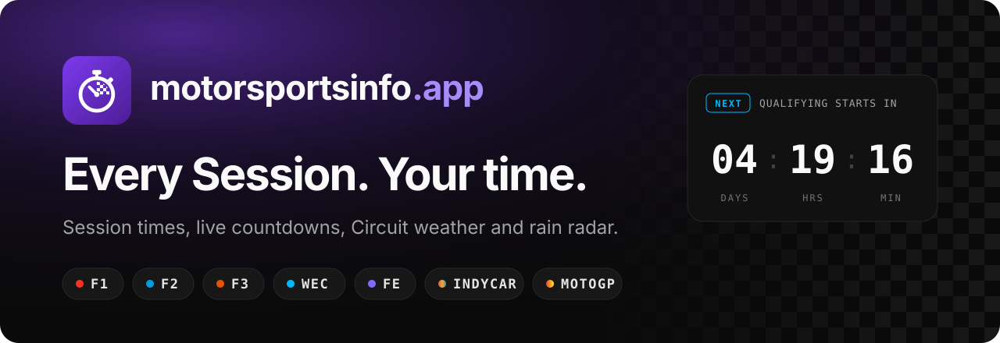
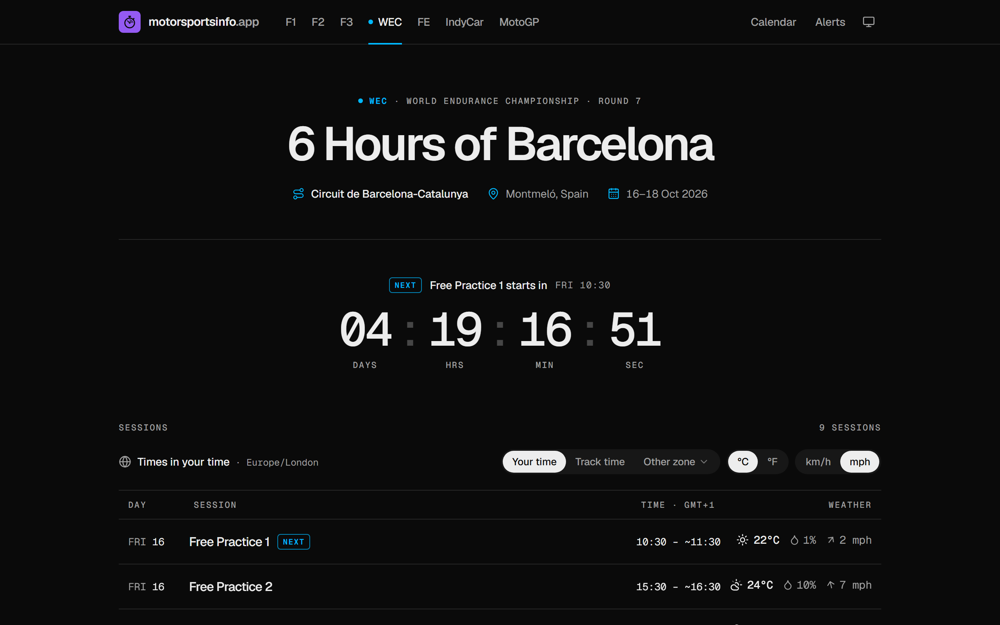
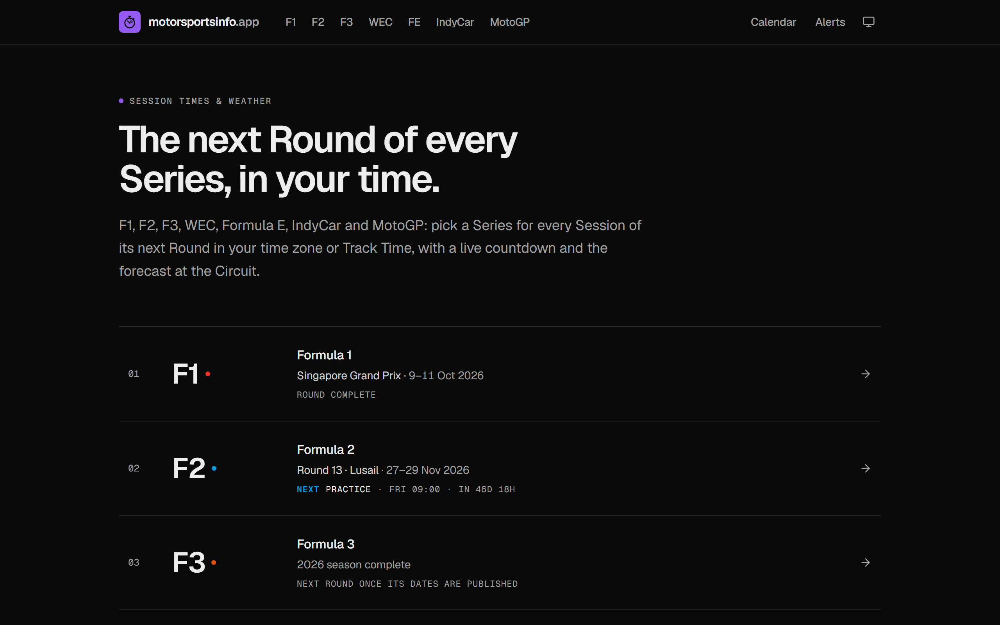
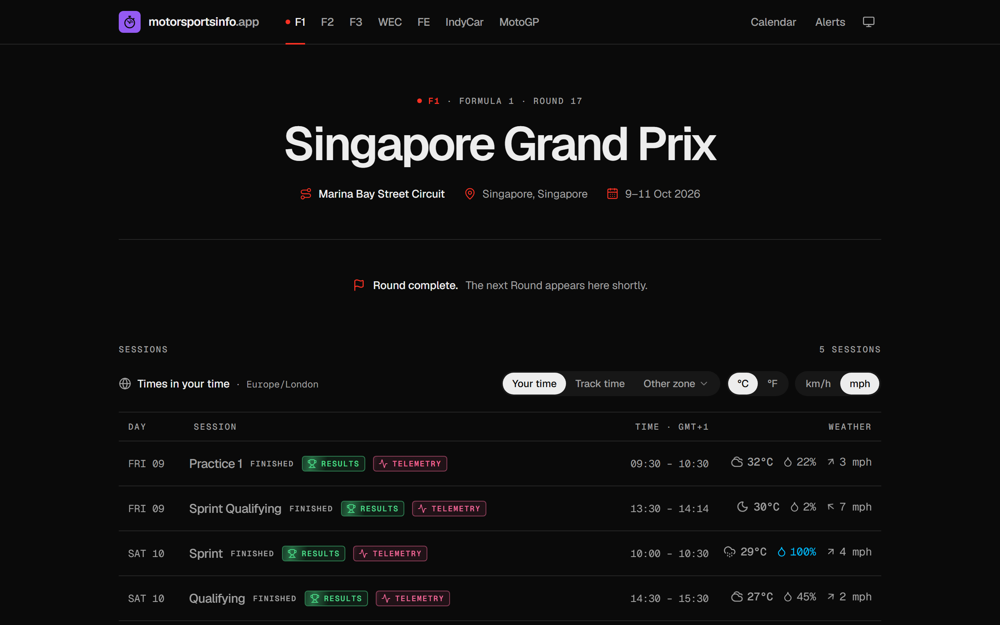
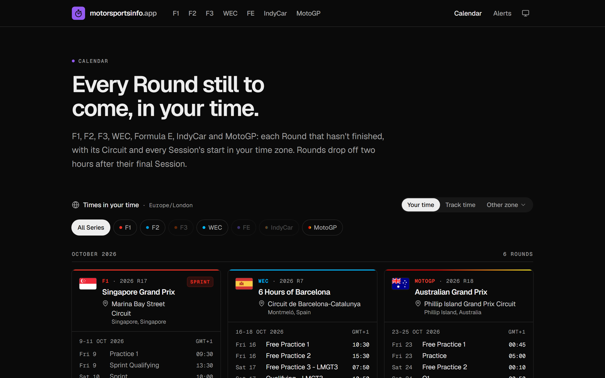
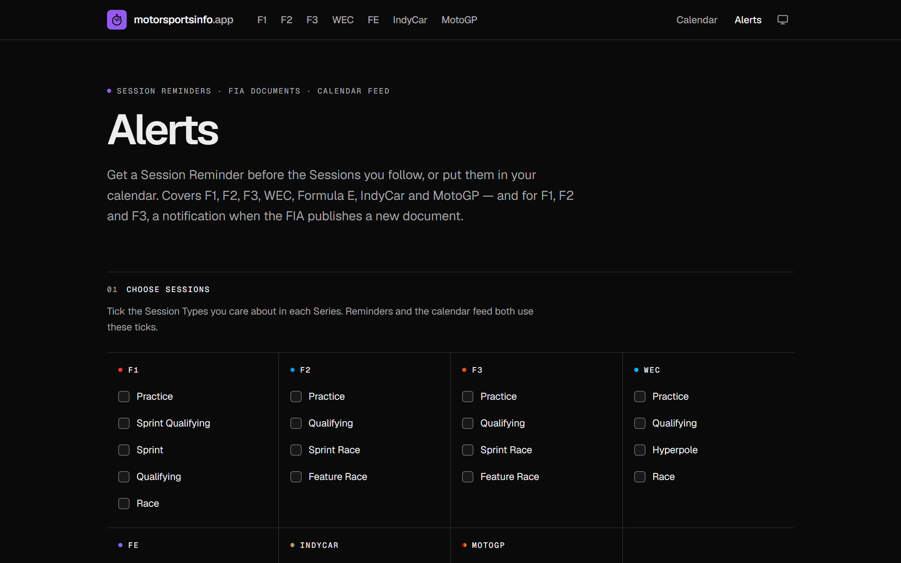
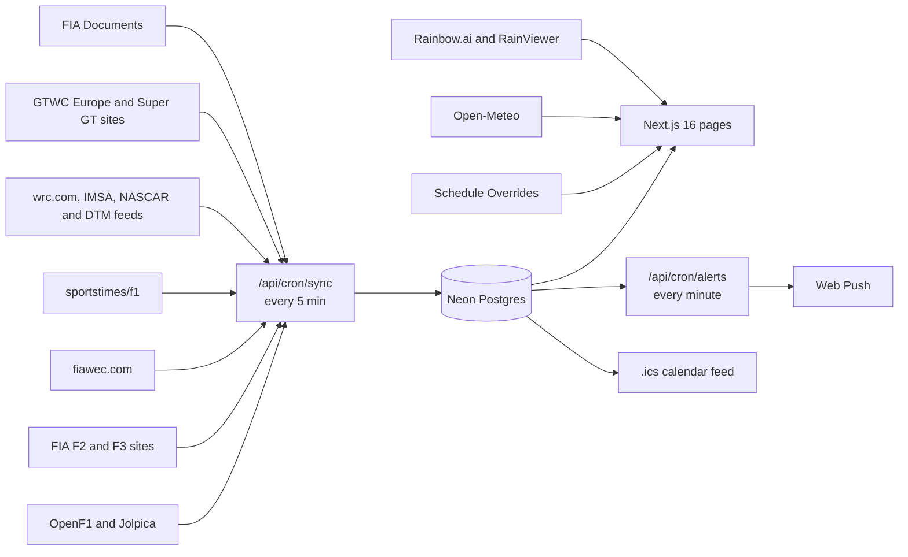

<div align="center">

<a href="https://motorsportsinfo.app"></a>

<br>

**When every Session runs and what the weather will do there, for F1, F2, F3, WEC, Formula E, IndyCar and MotoGP, plus F1 Academy, WRC, IMSA, NASCAR, GT World Challenge Europe, DTM and Super GT.**

[**motorsportsinfo.app**](https://motorsportsinfo.app) &nbsp;·&nbsp; [Calendar](https://motorsportsinfo.app/calendar) &nbsp;·&nbsp; [Alerts](https://motorsportsinfo.app/alerts) &nbsp;·&nbsp; [Domain language](CONTEXT.md) &nbsp;·&nbsp; [Decisions](docs/adr)

<br>

[](https://github.com/byalex33/motorsportsinfo.app/actions/workflows/ci.yml)


</div>

<br>

<a href="https://motorsportsinfo.app/wec"></a>

<table>
  <tr>
    <td width="50%"><a href="https://motorsportsinfo.app"></a></td>
    <td width="50%"><a href="https://motorsportsinfo.app/f1"></a></td>
  </tr>
  <tr>
    <td align="center"><sub><b>Home</b>: the next Round of every Series at a glance</sub></td>
    <td align="center"><sub><b>Series page</b>: Sessions in your time, with the weather at the Circuit</sub></td>
  </tr>
  <tr>
    <td width="50%"><a href="https://motorsportsinfo.app/calendar"></a></td>
    <td width="50%"><a href="https://motorsportsinfo.app/alerts"></a></td>
  </tr>
  <tr>
    <td align="center"><sub><b>Calendar</b>: every Round still to come, filterable by Series</sub></td>
    <td align="center"><sub><b>Alerts</b>: Session Reminders, Document Alerts and a calendar feed</sub></td>
  </tr>
</table>

## What it does

<table>
  <tr>
    <td width="33%" valign="top">
      <h4>Your time, or Track Time</h4>
      Every Session in your own time zone, the Circuit's local time, or any zone you pick. A live countdown runs to the next one.
    </td>
    <td width="33%" valign="top">
      <h4>Weather at the Circuit</h4>
      An Open-Meteo forecast for each Session: temperature, chance of rain and wind, in °C or °F and km/h or mph.
    </td>
    <td width="33%" valign="top">
      <h4>Rain radar</h4>
      For F1, a map around the Circuit near Session time: the Rainbow.ai forecast, or RainViewer's past two hours as a fallback.
    </td>
  </tr>
  <tr>
    <td valign="top">
      <h4>Session Reminders</h4>
      A web push before the Session Types you follow, and another when a Schedule Change moves one. Installs as an app.
    </td>
    <td valign="top">
      <h4>Calendar feed</h4>
      A subscribable <code>.ics</code> feed built from the same choices, so Sessions stay current in any calendar app.
    </td>
    <td valign="top">
      <h4>FIA Documents</h4>
      The F1, F2 and F3 documents for each Round in an in-page viewer, with a Document Alert when a new one is published.
    </td>
  </tr>
  <tr>
    <td valign="top">
      <h4>Session Results</h4>
      The full classification of a finished F1 Session, behind a spoiler warning. Never shown in the Session list.
    </td>
    <td valign="top">
      <h4>Telemetry</h4>
      Compare two drivers' fastest laps (speed, throttle, brake, gear and sector times) and share the comparison as an image.
    </td>
    <td valign="top">
      <h4>Spoiler-safe</h4>
      Session Results, Telemetry and car numbers in FIA Document titles stay hidden until you choose to see them.
    </td>
  </tr>
</table>

## Series covered

| Series | Schedule source | Fallback | Extras |
|---|---|---|---|
| **F1** | [OpenF1](https://openf1.org) | [Jolpica](https://jolpi.ca) | Rain radar, Session Results, Telemetry, FIA Documents |
| **F2** | [fiaformula2.com](https://www.fiaformula2.com) | [sportstimes/f1](https://github.com/sportstimes/f1) | FIA Documents |
| **F3** | [fiaformula3.com](https://www.fiaformula3.com) | sportstimes/f1 | FIA Documents |
| **WEC** | [fiawec.com](https://www.fiawec.com) | none | |
| **Formula E** | sportstimes/f1 | none | |
| **IndyCar** | sportstimes/f1 | none | |
| **MotoGP** | sportstimes/f1 | none | |
| **F1 Academy** | sportstimes/f1 | none | |
| **WRC** | [wrc.com](https://www.wrc.com) rally itineraries | none | |
| **IMSA** | IMSA's calendar feed (ECAL, `IMSA_CALENDAR_URL`) | none | |
| **NASCAR** (Cup) | [NASCAR's schedule feed](https://www.nascar.com) | none | |
| **GT World Challenge Europe** | [gt-world-challenge-europe.com](https://www.gt-world-challenge-europe.com) event timetables | none | |
| **DTM** | [dtm.com](https://www.dtm.com)'s content API | none | |
| **Super GT** | [supergt.net](https://supergt.net) race timetables | none | |

F2, F3, Formula E, F1 Academy, WRC, IMSA, GT World Challenge Europe, DTM and Super GT sit under **Other** in the header.

Why community data sources, and why that keeps the site non-commercial: [ADR 0001](docs/adr/0001-community-data-sources-keep-site-non-commercial.md).

## How it works



- **`/api/cron/sync`** runs every 5 minutes and decides per Series whether a source check is due: daily, every 2 hours during a Round, and 30 minutes before a Session. During an F1, F2 or F3 Round it also records new FIA Documents.
- **`/api/cron/alerts`** runs every minute and sends due Session Reminders, Schedule Change pushes and Document Alerts. It reads the database only.
- Both crons are declared in [`vercel.ts`](vercel.ts) and require `Authorization: Bearer $CRON_SECRET`. To force a check by hand, call `/api/cron/sync?series=f1&force=1` with that header.
- Without a database the site fetches the sources live, memoised for 15 minutes, so local development still renders real data.

## Getting started

You need Node.js 24 (what CI runs) and npm.

```bash
npm install
```

```bash
npm run dev
```

Open http://localhost:3000. That's enough to browse every Series with real data. Push reminders need a database and VAPID keys: copy [`.env.example`](.env.example) to `.env.local` and fill in what you need.

| Variable | What it's for |
|---|---|
| `DATABASE_URL` | Neon Postgres. Leave unset to read sources live without a database. |
| `CRON_SECRET` | Bearer token that protects `/api/cron/*`. |
| `NEXT_PUBLIC_VAPID_PUBLIC_KEY`, `VAPID_PRIVATE_KEY`, `VAPID_SUBJECT` | Web Push. Generate keys with `npx web-push generate-vapid-keys`. |
| `RAINBOW_API_KEY` | Rainbow.ai forecast radar tiles. Unset: the radar shows RainViewer's past 2 hours. |
| `RAINBOW_MONTHLY_TILE_CAP` | Forecast tiles fetched per month before the radar falls back to the past radar. Default 30000. |

### Scripts

| Command | Does |
|---|---|
| `npm run dev` | Start the dev server |
| `npm test` | Run the Vitest suite (`src/**/*.test.ts`) |
| `npm run typecheck` | Generate route types and run `tsc` |
| `npm run lint` | ESLint |
| `npm run build` | Production build |
| `npm run db:generate` | Generate a Drizzle migration from `src/db/schema.ts` |
| `npm run db:migrate` | Apply the migrations in `drizzle/` |

CI runs typecheck, lint and tests on every pull request and every push to `main`. Vercel builds the previews.

## Where things live

| Area | Where |
|---|---|
| Domain types and per-Series rules | `src/domain/` |
| Schedule sources, sync, Featured Round | `src/server/schedule/`, `src/app/api/cron/sync/` |
| Circuits and Schedule Overrides (edit by hand) | `src/data/circuits.ts`, `src/data/overrides.ts` |
| Weather (Open-Meteo) | `src/server/weather/`, `src/components/weather/` |
| Rain radar (Rainbow.ai forecast, RainViewer past, on OpenFreeMap) | `src/server/radar/`, `src/components/radar/`, `src/app/api/radar/` |
| Calendar page and calendar feeds | `src/app/calendar/`, `src/components/calendar/` |
| Session Reminders, Schedule Change pushes, Document Alerts | `src/server/alerts/`, `src/app/alerts/`, `src/app/api/cron/alerts/` |
| OpenF1 client | `src/server/openf1/` |
| Session Results | `src/server/results/`, `src/app/api/results/` |
| Telemetry | `src/server/telemetry/`, `src/app/[series]/telemetry/`, `src/components/telemetry/` |
| FIA Documents | `src/server/documents/`, `src/app/[series]/documents/`, `src/app/documents/`, `src/components/documents/` |
| Analytics (Tracwell) | `src/lib/analytics.ts` |
| Database schema (Drizzle + Neon) | `src/db/schema.ts` |

UI code imports schedule data only from `src/server/schedule`, and weather, Session Results, Telemetry and FIA Documents only from their own `src/server/*` module. The words used in code and copy (Series, Round, Featured Round, Session, Track Time and the rest) are defined in [CONTEXT.md](CONTEXT.md).

### Correcting a Session by hand

Add an entry to `src/data/overrides.ts` (Session id, new time or status, reason), then commit and deploy. It takes precedence over the source until you remove it.

## Data and credits

The site is non-commercial and uses no official Series logos or marks. It relies on these sources, all credited on the site:

- Data: [OpenF1](https://openf1.org)
- [Weather data by Open-Meteo.com](https://open-meteo.com)
- Forecast radar: [Rainbow.ai](https://www.rainbow.ai)
- Radar: [RainViewer](https://www.rainviewer.com)
- Documents: [FIA](https://www.fia.com)
- Schedules: [sportstimes/f1](https://github.com/sportstimes/f1), [Jolpica](https://jolpi.ca), the official F2, F3, WEC, WRC, GT World Challenge Europe and Super GT sites, and IMSA's, NASCAR's and DTM's own schedule feeds
- Base map: [OpenFreeMap](https://openfreemap.org)
